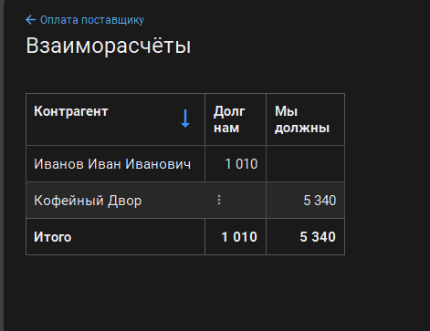

# Coffee ERP

Мини-ERP на 1С:Предприятие 8.5 (учебная версия) для магазина кофе и чая:
закупки, склад, продажи через сайт, зарплата.

**Статус:** в разработке. Готово: справочники, закупки, склад, продажи, контроль остатков, взаиморасчёты.
В планах: резервирование, инвентаризация, HTTP-сервис и сайт-витрина, зарплата, роли и права, автотесты обмена.

## Что уже работает

### Закупки → склад
- Документ «Заказ поставщику» фиксирует договорённость: закупочная цена подставляется из справочника «Номенклатура», сумма считается автоматически.
- Документ «Поступление товаров» создаётся на основании заказа поставщику и приходует остатки на склад. По одному заказу нельзя оприходовать товар дважды.
- По регистру накопления «ОстаткиТоваров» строится отчёт на СКД «Остатки товаров» (склад → номенклатура).


### Продажи
- Документ «Заказ покупателя» со статусом (`Новый`, `Собран`, `Отправлен`, `Выполнен`, `Отменён`). Статус `Новый` ставится автоматически, цена и сумма подставляются при выборе товара.
- Документ «Реализация товаров» создаётся на основании заказа: покупатель, склад и товары переносятся автоматически. После проведения статус заказа меняется на `Выполнен`.

### Контроль остатков и защита от ошибок
- Реализация не проводится, если товара не хватает: проведение отменяется, остатки и расчёты не меняются.
- Один заказ нельзя отгрузить дважды: повторная реализация по тому же заказу отклоняется. Дефект найден при ручном тестировании и исправлен.
- Отказ в проведении не меняет статус заказа.


### Взаиморасчёты с контрагентами
Реализация создаёт долг покупателя, поступление создаёт долг перед поставщиком. Документы «Оплата от покупателя» и «Оплата поставщику» уменьшают долг. Отчёт «Взаиморасчёты» показывает в двух колонках, кто должен нам и кому должны мы.



## Состав конфигурации

| Тип | Объекты |
|---|---|
| Справочники | Номенклатура, Склады, Контрагенты, Сотрудники |
| Документы | ЗаказПоставщику, ПоступлениеТоваров, ЗаказПокупателя, РеализацияТоваров, ОплатаОтПокупателя, ОплатаПоставщику |
| Регистры накопления | ОстаткиТоваров, Взаиморасчеты |
| Перечисления | СтатусыЗаказа |
| Отчёты | ОстаткиТоваров, Взаиморасчеты (СКД) |
| HTTP-сервисы | Test (проверка публикации, `/ping`) |
| Подсистемы | НСИ, Закупки, Склад, Продажи, Финансы |

Интерфейс: «Версия 8.5» (новый интерфейс платформы 1С:Предприятие 8.5).

## Структура репозитория

```
1c-config/        конфигурация, выгруженная в файлы
shop-site/        сайт-витрина (в планах)
exchange-tests/   автотесты обмена (в планах)
docs/             скриншоты и тест-кейсы
```

## Как развернуть

1. Установить учебную версию платформы 1С:Предприятие 8.5 (бесплатно, с сайта 1С).
2. Создать пустую файловую базу без конфигурации.
3. В Конфигураторе: «Конфигурация» → «Загрузить конфигурацию из файлов», выбрать папку `1c-config`, затем обновить конфигурацию базы данных (F7).
4. Создать тестовые данные: несколько товаров (с закупочной и продажной ценой), склад, поставщика и покупателя.

Особенности учебной версии: один сеанс на базу, лимиты на количество записей, нет клиент-серверного режима.

## Тестирование

Ручные тест-кейсы лежат в [docs/test-cases.md](docs/test-cases.md). Они покрывают продажу в пределах остатка и в минус, подстановку цены, реализацию и поступление на основании заказа, защиту от повторной отгрузки и оприходования, взаиморасчёты и оплаты (15 кейсов).

## Планы

- [ ] Резервирование товара под заказ покупателя, свободные остатки
- [ ] Инвентаризация
- [ ] HTTP-сервис каталога и приём заказов с сайта
- [ ] Сайт-витрина (Python)
- [ ] Зарплата: оклад, премия от продаж, расчётный листок
- [ ] Роли и права: менеджер, кладовщик, бухгалтер
- [ ] Автотесты обмена (pytest)