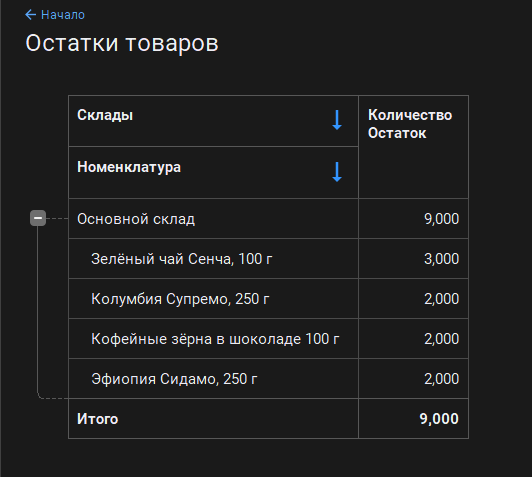
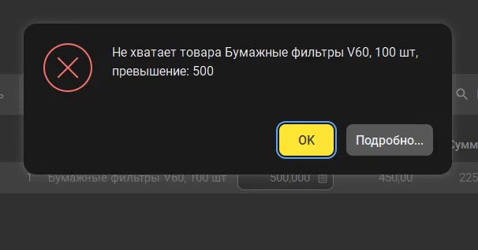
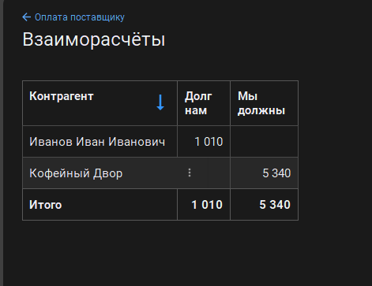

# Coffee ERP

Мини-ERP на 1С:Предприятие 8.5 (учебная версия) для магазина кофе и чая:
закупки, склад, продажи, взаиморасчёты и сайт-витрина, который получает каталог из 1С.

**Статус:** в разработке. Готово: справочники, закупки, склад, продажи, контроль остатков, резервирование товара под заказ, взаиморасчёты, сайт-витрина с корзиной и оформлением заказа, HTTP-обмен с 1С, 59 автотестов на pytest.
В планах: инвентаризация, зарплата, роли и права.

## Что уже работает

### Закупки → склад
- Документ «Заказ поставщику» фиксирует договорённость: закупочная цена подставляется из справочника «Номенклатура», сумма считается автоматически.
- Документ «Поступление товаров» создаётся на основании заказа поставщику и приходует остатки на склад. По одному заказу нельзя оприходовать товар дважды.
- По регистру накопления «ОстаткиТоваров» строится отчёт на СКД «Остатки товаров» (склад → номенклатура).



### Продажи
- Документ «Заказ покупателя» со статусом (`Новый`, `Собран`, `Отправлен`, `Выполнен`, `Отменён`). Статус `Новый` ставится автоматически, цена и сумма подставляются при выборе товара.
- Документ «Реализация товаров» создаётся на основании заказа: покупатель, склад и товары переносятся автоматически. После проведения статус заказа меняется на `Выполнен`.

### Резервирование товара под заказ
- Заказ покупателя проводится и резервирует товар в регистре «РезервыТоваров». Любое сохранение заказа пересчитывает резерв: при статусах `Отменён` и `Выполнен` заказ ничего не резервирует.
- Доступное количество = остаток на складе минус резерв. Именно его видит сайт (`stock` в каталоге) и по нему проверяются новые заказы, поэтому последнюю единицу не получат двое покупателей.
- Реализация по заказу списывает товар со склада, а заказ получает статус `Выполнен` и снимает резерв.
- Отчёт «Остатки товаров» показывает три колонки: остаток, резерв, доступно.


### Контроль остатков и защита от ошибок
- Реализация не проводится, если товара не хватает: проведение отменяется, остатки и расчёты не меняются.
- Один заказ нельзя отгрузить дважды: повторная реализация по тому же заказу отклоняется. Дефект найден при ручном тестировании и исправлен.
- Отказ в проведении не меняет статус заказа.



### Взаиморасчёты с контрагентами
Реализация создаёт долг покупателя, поступление создаёт долг перед поставщиком. Документы «Оплата от покупателя» и «Оплата поставщику» уменьшают долг. Отчёт «Взаиморасчёты» показывает в двух колонках, кто должен нам и кому должны мы.



### Сайт-витрина
Сайт на FastAPI работает поверх HTTP-сервиса `Shop`. Цены, описания и доступные остатки всегда актуальны: проведённое в 1С поступление, реализация или заказ сразу меняют наличие на сайте. Бизнес-логика и данные остаются в 1С, сайт только отображает каталог и передаёт заказы.

- Корзина хранится в cookie. При оформлении заказ уходит в 1С (`POST /orders`), цены берутся из справочника 1С, а не от сайта.
- Страница заказа показывает статус заказа и открывается только по номеру и email покупателя.

- Фильтры: категория, поиск по названию, «только в наличии», диапазон цен, сортировка.
- Фото товаров подхватываются из `shop-site/static/img/` по артикулу (`COF-001.jpg`); если файла нет, показывается заглушка категории.
- Если 1С недоступна, сайт не падает, а показывает сообщение.
- Служебные адреса: `/health` (проверка связи с 1С), `/api/catalog` (каталог в JSON), `/docs` (документация API).

## Как это связано

```
Браузер  →  FastAPI (shop-site)  →  HTTP-сервис 1С (/hs/shop/...)  →  база 1С
```

### HTTP-сервис 1С

Адрес: `http://127.0.0.1/ERP-Shop-demo/hs/shop`

| Метод | Адрес | Назначение | Ответы |
|---|---|---|---|
| GET | `/catalog` | Каталог с доступными остатками (`stock` = остаток минус резерв) | 200 |
| POST | `/orders` | Создать заказ покупателя и зарезервировать товар | 201, 400 (неверные данные), 409 (не хватает доступного товара) |
| GET | `/orders/{номер}?email=` | Статус и состав заказа | 200, 400 (нет email), 404 (заказ не найден или чужой email) |
| POST | `/orders/{номер}/cancel?email=` | Отменить заказ и снять резерв | 200, 400, 404, 409 (заказ уже отправлен или выполнен) |

Чужой email и несуществующий номер дают один и тот же ответ 404, чтобы по API нельзя было перебирать чужие заказы. Повторная отмена безопасна.

## Состав конфигурации

| Тип | Объекты |
|---|---|
| Справочники | Номенклатура, Склады, Контрагенты, Сотрудники |
| Документы | ЗаказПоставщику, ПоступлениеТоваров, ЗаказПокупателя, РеализацияТоваров, ОплатаОтПокупателя, ОплатаПоставщику |
| Регистры накопления | ОстаткиТоваров, РезервыТоваров, Взаиморасчеты |
| Перечисления | СтатусыЗаказа |
| Отчёты | ОстаткиТоваров, Взаиморасчеты (СКД) |
| HTTP-сервисы | Shop (каталог, заказы, статус и отмена заказа), Test (проверка публикации, `/ping`) |
| Подсистемы | НСИ, Закупки, Склад, Продажи, Финансы |

Интерфейс: «Версия 8.5» (новый интерфейс платформы 1С:Предприятие 8.5).

## Структура репозитория

```
1c-config/        конфигурация, выгруженная в файлы
shop-site/        сайт-витрина на FastAPI (main.py, templates, static)
exchange-tests/   автотесты HTTP-сервиса и сайта (pytest) и примеры запросов (*.json)
docs/             скриншоты и тест-кейсы
```

## Как развернуть

### 1С
1. Установить учебную версию платформы 1С:Предприятие 8.5 (бесплатно, с сайта 1С).
2. Создать пустую файловую базу без конфигурации.
3. В Конфигураторе: «Конфигурация» → «Загрузить конфигурацию из файлов», выбрать папку `1c-config`, затем обновить конфигурацию базы данных (F7).
4. Создать тестовые данные: несколько товаров (с артикулом вида `COF-001`, закупочной и продажной ценой), склад, поставщика и покупателя; провести поступление, чтобы появились остатки.
5. Опубликовать базу на веб-сервере (Конфигуратор от имени администратора → «Администрирование» → «Публикация на веб-сервере»), включив публикацию HTTP-сервисов. На Windows для этого нужен IIS с расширениями ISAPI, модуль расширения веб-сервера из установщика платформы и права на папку базы для `IUSR` и `IIS_IUSRS`. Для 32-разрядной платформы в пуле приложений IIS включить «Разрешены 32-разрядные приложения».
6. Проверить в браузере: `http://localhost/ERP-Shop/hs/shop/catalog` должен вернуть JSON.

### Сайт
```
cd shop-site
python -m venv .venv
.venv\Scripts\activate
pip install -r requirements.txt
uvicorn main:app --reload
```
Сайт откроется на `http://127.0.0.1:8000`. Адрес 1С задаётся переменной окружения `ONEC_BASE_URL` (по умолчанию `http://127.0.0.1/ERP-Shop/hs/shop`).

Особенности учебной версии платформы: один сеанс на базу, лимиты на количество записей, нет клиент-серверного режима.

## Тестирование

### Ручные тест-кейсы
[docs/test-cases.md](docs/test-cases.md): продажа в пределах остатка и в минус, подстановка цены, реализация и поступление на основании заказа, защита от повторной отгрузки, взаиморасчёты, каталог и заказ с сайта, резервирование и отмена заказа. Для кейсов с автотестом указано соответствие.

### Автотесты (pytest)
Папка `exchange-tests`, 59 тестов:

| Файл | Тестов | Что проверяет |
|---|---|---|
| `test_catalog.py` | 7 | структура каталога, цены, остатки, уникальность и формат артикулов |
| `test_orders.py` | 29 | создание заказа, нехватка товара (409), 10 вариантов некорректных позиций, данные покупателя, битый JSON, статус заказа, доступ по чужому email |
| `test_reservation.py` | 8 | резерв при заказе, возврат при отмене, чужой email, повторная отмена, вторая покупка последней единицы |
| `test_site.py` | 15 | страницы сайта, фильтры, корзина, оформление заказа, сквозной сценарий «сайт → 1С → страница заказа» |

Запуск (база опубликована, Конфигуратор и клиент 1С закрыты):

```
cd exchange-tests
pip install -r requirements.txt
pytest
```

По умолчанию тесты ходят в `http://127.0.0.1/ERP-Shop-demo/hs/shop`, другой адрес задаётся переменной `ONEC_BASE_URL`. Тесты создают заказы с email `autotest@example.com` и после каждого теста отменяют их через `POST /orders/{номер}/cancel`, поэтому резерв не накапливается. Для тестовых прогонов используется отдельная публикуемая база: обычная рабочая база остаётся доступной для Конфигуратора (в учебной версии одно подключение к базе).

### Найденные дефекты

| Дефект | Как найден | Статус |
|---|---|---|
| Повторная реализация по одному заказу проводилась и дважды списывала товар | ручное тестирование | исправлен |
| `GET /orders/{номер}` без параметра `email` возвращал 500 вместо 400 | автотест `test_status_requires_email` | исправлен |
| После включения резервирования автотесты исчерпывали остаток и падали с 409 | запуск автотестов | исправлено: тесты отменяют свои заказы |

## Известные ограничения

- Учебная версия платформы допускает одно подключение к базе, поэтому сайт сериализует запросы к 1С и повторяет запрос при ошибке лимита.
- Каталог на сайте кэшируется на 5 секунд.
- Отмена заказа есть в HTTP-сервисе, но кнопки отмены на сайте пока нет.
- Старые заказы, созданные до включения резервирования, резерв не держат.

## Планы

- [x] Резервирование товара под заказ покупателя, свободные остатки
- [x] Приём заказов с сайта (корзина, оформление, статус заказа)
- [x] Автотесты обмена (pytest)
- [ ] Роли и права: кладовщик, продавец, бухгалтер, директор
- [ ] Зарплата: оклад, премия от продаж, расчётный листок
- [ ] Инвентаризация
- [ ] Кнопка отмены заказа на сайте
