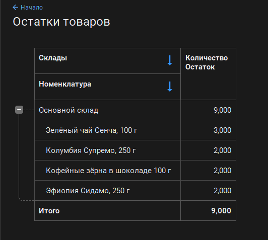
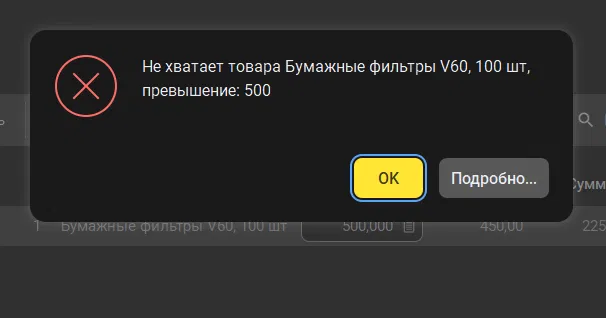

# Coffee ERP

Мини-ERP на 1С:Предприятие 8.5 (учебная версия) для магазина кофе и чая:
закупки, склад, продажи через сайт, зарплата.

Статус: в разработке (справочники, поступление товаров, регистр остатков).

## Что уже работает

**Закупки → склад.** Поступление товаров приходует остатки на склад, по ним строится отчёт.

**Контроль остатков при продаже.** Реализация не проводится, если товара не хватает.

